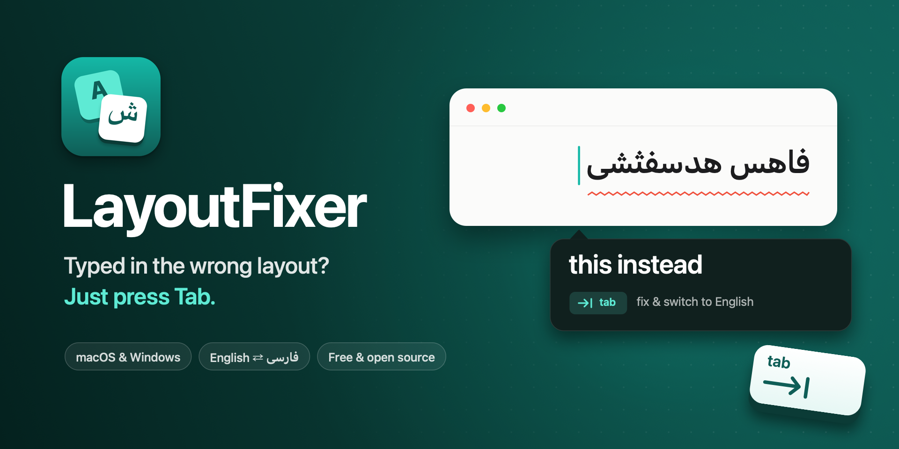

<p align="center">
  
</p>

<p align="center">
  Typed a whole sentence with the wrong keyboard layout? Press <kbd>Tab</kbd>.<br>
  A tiny app for <b>macOS</b> and <b>Windows</b> that fixes English ⇄ Persian layout mistakes as you type.
</p>

<p align="center">
  <a href="https://github.com/sina-developer/LayoutFixer/releases/latest/download/LayoutFixer-macOS.zip"><b>Download for macOS</b></a>
  &nbsp;·&nbsp;
  <a href="https://github.com/sina-developer/LayoutFixer/releases/latest/download/LayoutFixer-Windows-x64.zip"><b>Download for Windows</b></a>
</p>

<p align="center">
  
</p>

---

You meant to write:

```
want to grab lunch today
```

but the keyboard was still on Persian, so you got:

```
صشدف فخ لقشذ معدزا فخیشغ
```

LayoutFixer notices, shows a small popup next to your cursor, and when you press <kbd>Tab</kbd> it
retypes the text in the right language **and switches your keyboard layout** for you. It works the
other way too: `sghl` → `سلام`.

## Features

- Works in every app: browsers, chat apps, editors, mail.
- Asks before changing anything. <kbd>Tab</kbd> fixes it, <kbd>Esc</kbd> (or just keep typing) ignores it.
- Only steps in when it's sure: names, brands and typos (`github`, `figma`, `teh`) are never touched.
- Fixes the whole run of wrong words, not just the last one.
- Switches your keyboard layout so the next words come out right.
- Fully offline. Nothing is stored or sent anywhere.

## Install

You need both an **English** and a **Persian** keyboard layout. LayoutFixer reads your real layouts
(US, ABC, Persian, Persian-ISIRI 2901, …), so the key mapping always matches your keyboard.

| Download | For |
|---|---|
| [`LayoutFixer-macOS.zip`](https://github.com/sina-developer/LayoutFixer/releases/latest/download/LayoutFixer-macOS.zip) | macOS 13 or later, Apple silicon and Intel |
| [`LayoutFixer-Windows-x64.zip`](https://github.com/sina-developer/LayoutFixer/releases/latest/download/LayoutFixer-Windows-x64.zip) | Windows 10 and 11, most PCs |
| [`LayoutFixer-Windows-arm64.zip`](https://github.com/sina-developer/LayoutFixer/releases/latest/download/LayoutFixer-Windows-arm64.zip) | Windows on ARM (Snapdragon laptops) |

### macOS

1. Download [`LayoutFixer-macOS.zip`](https://github.com/sina-developer/LayoutFixer/releases/latest/download/LayoutFixer-macOS.zip), unzip it and move **LayoutFixer** to **Applications**.
2. Open it. The app isn't notarized by Apple yet, so macOS blocks the first launch: go to
   **System Settings → Privacy & Security** and click **Open Anyway**.
3. Allow **Accessibility** when asked (**System Settings → Privacy & Security → Accessibility →
   LayoutFixer**). It starts working within a couple of seconds.
4. Optional: add it to **System Settings → General → Login Items** so it starts with your Mac.

No Persian layout yet? **System Settings → Keyboard → Text Input → Edit… → +** and add **Persian**.

### Windows

1. **Pick the right download.** Most PCs need
   [`LayoutFixer-Windows-x64.zip`](https://github.com/sina-developer/LayoutFixer/releases/latest/download/LayoutFixer-Windows-x64.zip).
   Not sure? Open **Settings → System → About** and look at **System type**: "ARM-based processor"
   means you need
   [`LayoutFixer-Windows-arm64.zip`](https://github.com/sina-developer/LayoutFixer/releases/latest/download/LayoutFixer-Windows-arm64.zip).
2. **Unzip it.** Right-click the zip → **Extract All…**, and pick a folder you'll keep, for example
   `Documents\LayoutFixer`. Keep `LayoutFixer.exe` and the `data` folder next to each other.
3. **Run `LayoutFixer.exe`.** The app isn't signed by Microsoft yet, so the first time Windows may
   say *Windows protected your PC*: click **More info → Run anyway**.
4. **Find it in the tray.** LayoutFixer has no window. Its icon sits in the system tray next to the
   clock (click **^** if you don't see it). Right-click it for:
   - **Enabled**: turn fixing on or off
   - **Start with Windows**: launch it automatically when you sign in
   - **Quit LayoutFixer**
5. **Try it.** Switch your keyboard to English, type `sghl` and a space in Notepad, then press
   <kbd>Tab</kbd> when the popup appears.

No permissions to grant on Windows.

**Add the Persian keyboard:** **Settings → Time & language → Language & region → Add a language →
Persian (فارسی)**, then switch layouts with <kbd>Win</kbd> + <kbd>Space</kbd>. If LayoutFixer's tray
menu says *Add both an English and a Persian keyboard layout*, one of them is missing.

**Update:** quit LayoutFixer from the tray, then replace the folder with the new download.

**Uninstall:** quit it from the tray, turn off **Start with Windows** if you turned it on, then
delete the folder.

## How it works

Every key has a twin on the other layout: `t` is also `ف`, `h` is also `ا`. LayoutFixer only
suggests a fix when the other reading is a **real word**:

| You're typing on… | It flags a word when… | Suggests |
|---|---|---|
| Persian layout | the same keys spell a common English word (`صشدف` → `want`) | English |
| English layout | it isn't an English word **and** the same keys spell a real Persian word (`sghl` → `سلام`) | Persian |

So names, brands and typos (`github`, `figma`, `teh`) are never touched: their Persian reading is
gibberish.

- Words are checked when you press <kbd>Space</kbd>.
- 2-letter words are ambiguous (the Persian word `شد` is `an` on English keys), so they're only
  included when the word next to them is clearly wrong too.
- The physical keys you pressed are recorded and translated with the other layout, so the
  conversion is exact for whatever layouts you use.
- The word lists are 50k-word English and Persian frequency lists plus Webster's word list, all bundled.

### Known limits

- **Popup position.** The popup appears at the text cursor. Apps that don't report where the cursor is
  (some Electron apps) get it at the mouse pointer instead.
- **Password fields.** Typing there is protected by the system, so LayoutFixer never sees it.
- **Windows admin apps.** Apps running *as administrator* can't be watched unless LayoutFixer also
  runs as administrator.
- **macOS rebuilds.** If you build the Mac app yourself, macOS treats every new build as a new app:
  remove LayoutFixer from the Accessibility list with **−** and allow it again.

## Privacy

This is a keyboard monitor, so here is exactly what it does:

- It keeps only the last few words you typed, in memory, to check them and retype them.
- That memory is cleared when you click, use arrow keys, use shortcuts, or switch apps.
- Nothing is written to disk, logged, or sent over the network. The app makes no network requests.

The code is small enough to read: the Mac app is one file, [`Sources/main.swift`](Sources/main.swift),
and the Windows app is six short files in [`windows/src`](windows/src).

## Build from source

**macOS:** needs only the Xcode Command Line Tools (`xcode-select --install`).

```bash
git clone https://github.com/sina-developer/LayoutFixer.git
cd LayoutFixer
./scripts/build.sh
open build/LayoutFixer.app
```

**Windows:** needs the [.NET 10 SDK](https://dotnet.microsoft.com/download). It also compiles on
macOS and Linux, but only runs on Windows.

```bash
dotnet publish windows/LayoutFixer.Windows.csproj -c Release -r win-x64 --self-contained true -p:PublishSingleFile=true
```

**Test the detection without running the app:**

```bash
./build/LayoutFixer.app/Contents/MacOS/LayoutFixer --test "صشدف لقشذ معدزا"
# صشدف -> want  FIX
# لقشذ -> grab  FIX
# معدزا -> lunch  FIX
```

On Windows the same works with `LayoutFixer.exe --test "…"`.

**Releases:** pushing a tag like `v0.3.0` builds both apps on GitHub Actions and publishes the
release ([`.github/workflows/release.yml`](.github/workflows/release.yml)).

```
Sources/main.swift       Mac app: event tap, detection, popup, menu bar
windows/src/             Windows app: keyboard hook, detection, popup, tray
Resources/               word lists and icons (shared by both apps)
icon/                    icon and cover drawing scripts (run scripts/make-icons.sh)
scripts/build.sh         builds build/LayoutFixer.app (--zip for a release zip)
```

## Contributing

Ideas and pull requests are welcome, for example:

- More language pairs (Arabic, Russian, Hebrew, …)
- A settings window (auto-fix without asking, per-app exclusions)
- Learning from words you dismiss
- Signed and notarized releases

## Credits

- English and Persian word frequencies: [FrequencyWords](https://github.com/hermitdave/FrequencyWords) by
  Hermit Dave, licensed under [CC BY-SA 4.0](https://creativecommons.org/licenses/by-sa/4.0/).
- English word list on Windows: Webster's Second International (public domain).
- See [THIRD_PARTY_NOTICES.md](THIRD_PARTY_NOTICES.md).

## Author

Made by **Sina Gholizadeh**.

- Website: [c-na.dev](https://c-na.dev)
- Email: [hi@c-na.dev](mailto:hi@c-na.dev)

Questions, bugs or ideas: [open an issue](https://github.com/sina-developer/LayoutFixer/issues) or send an email.

## License

[MIT](LICENSE)
